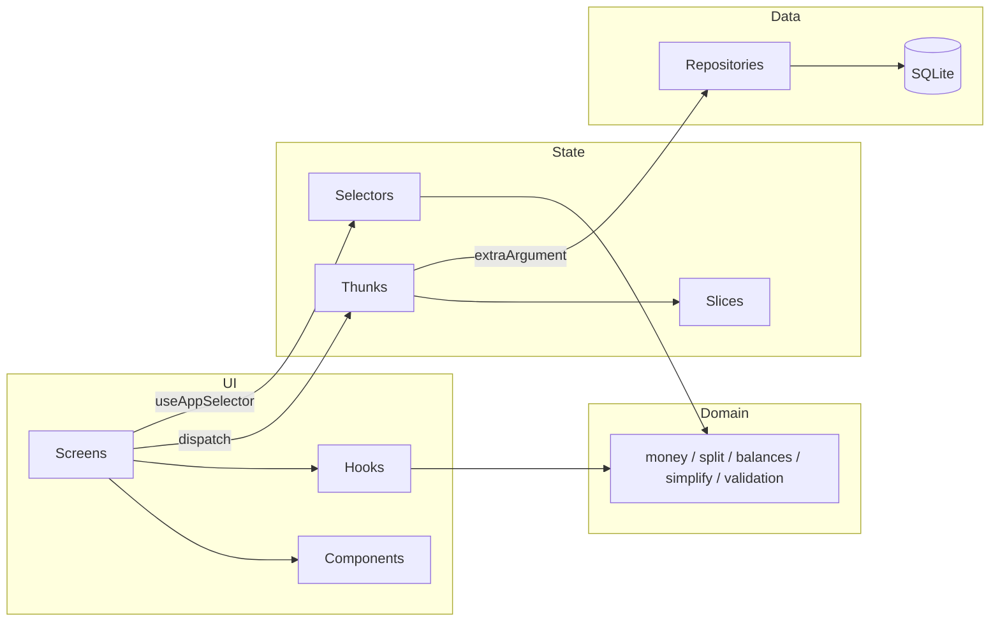

# Evenly

**Offline-first group expense splitting for iOS and Android.** Track shared costs on a trip, in a
flat or after a night out, see who owes whom, and settle up in the fewest possible payments.

Built with React Native, Expo, TypeScript, Redux Toolkit and SQLite. No account, no server:
everything lives on the device.

---

## Features

- **Groups** with their own currency, emoji and members. Archive old ones instead of deleting.
- **Four ways to split** an expense: equally, by exact amounts, by percentage or by shares
  (including half shares).
- **Multiple payers** for one expense, for when two people split the bill at the till.
- **Exact money maths.** Every amount is an integer number of minor units, and uneven splits use
  the largest-remainder method so totals always add up to the cent. The leftover cent rotates
  between people instead of always landing on the same person.
- **Debt simplification** that finds the *minimum* number of payments (exact algorithm, not just a
  greedy heuristic), with a per-group switch for people who prefer to only pay those they
  actually shared costs with.
- **Settle up** from a suggested payment in one tap, or record any payment manually.
- **Insights**: spend by category and paid-vs-consumed per person.
- **Activity feed** across all groups, grouped by day.
- **CSV export** of a group ledger, safe to open in Excel or Google Sheets (formula-injection
  protected, UTF-8 BOM).
- **Light and dark themes**, haptics, deep links (`evenly://group/<id>`), and screen-reader labels
  on every interactive element.

## Tech stack

| Concern | Choice |
| --- | --- |
| Framework | Expo SDK 57, React Native 0.86, React 19 |
| Language | TypeScript (strict, `noUncheckedIndexedAccess`) |
| State | Redux Toolkit — entity adapters, typed thunks, memoised selectors |
| Persistence | `expo-sqlite` with versioned migrations |
| Navigation | React Navigation 7 (native stack + bottom tabs) |
| Testing | Jest (`jest-expo`) + `sql.js` for real-SQLite repository tests |
| Quality | ESLint (`eslint-config-expo`), Prettier, GitHub Actions CI |

## Getting started

```bash
git clone https://github.com/<your-username>/evenly.git
cd evenly
npm install
npm start
```

Then press `i` for the iOS simulator, `a` for an Android emulator, or scan the QR code with
Expo Go. Every native module used is included in Expo Go, so no development build is required.

### Scripts

| Command | What it does |
| --- | --- |
| `npm start` | Start the Metro dev server |
| `npm test` | Run the unit and integration tests |
| `npm run test:coverage` | Tests with coverage (domain layer has a 90% threshold) |
| `npm run typecheck` | `tsc --noEmit` |
| `npm run lint` | ESLint |
| `npm run verify` | Typecheck, lint and test — the same gate CI runs |

## Architecture



The code is split into four layers with a strict dependency direction:

- **`src/domain`** — pure TypeScript with no React or Expo imports: money parsing and allocation,
  split strategies, balances, debt simplification, validation, CSV. This is where the interesting
  logic lives and where most of the tests are.
- **`src/data`** — SQLite schema, migrations and repositories behind a small `SqlDatabase`
  interface, so the same code runs against `expo-sqlite` on device and `sql.js` in Jest.
- **`src/store`** — Redux Toolkit slices and thunks. Repositories, the clock and the id generator
  are injected through the thunk `extraArgument`, which makes the store fully testable.
- **`src/screens` / `src/components`** — React Native UI. Screens read through memoised selectors
  and never touch the database directly.

More detail, including the data model and the reasoning behind the main decisions, is in
[`docs/ARCHITECTURE.md`](docs/ARCHITECTURE.md). The splitting and simplification algorithms are
explained step by step in [`docs/ALGORITHMS.md`](docs/ALGORITHMS.md).

## Project structure

```
src/
├── App.tsx                 # Boot: open DB → create store → hydrate → render
├── domain/                 # Pure business logic (+ __tests__)
├── data/
│   ├── db/                 # SqlDatabase interface, migrations, expo-sqlite adapter
│   └── repositories/       # Groups, members, expenses, settlements, settings
├── store/                  # Slices, thunks, selectors, typed hooks
├── navigation/             # Navigators, route types, deep linking
├── screens/                # One folder per feature
├── components/             # ui/ primitives + feature components
├── hooks/                  # useExpenseForm, useGroup, useMoney
├── theme/                  # Tokens, light/dark themes, makeStyles
├── utils/                  # Formatting, user-facing messages, haptics, export
└── test/                   # Test database and fixtures
```

## Testing

```bash
npm test
```

- **Domain tests** cover parsing edge cases (decimal commas, grouping separators, zero- and
  three-decimal currencies), allocation invariants, every split method, balances, pairwise
  debts and CSV escaping.
- **Debt simplification** is checked against a brute-force oracle on 200 random ledgers to prove
  the result is always the true minimum number of payments.
- **Repository tests** run real SQL through `sql.js`, including migration rollback, foreign key
  and `CHECK` constraints, and cascade deletes.
- **Store tests** drive the real thunks and selectors end to end: create a group, add expenses,
  follow the suggested payments and assert everyone ends up settled.

## Roadmap

- [ ] Recurring expenses (rent, subscriptions)
- [ ] Receipt photos attached to expenses
- [ ] Multi-currency expenses inside one group, with a stored exchange rate per expense
- [ ] Optional sync between devices (CRDT-based, still offline-first)
- [ ] Localisation (copy is already centralised in `src/utils/messages.ts`)

## Contributing

Issues and pull requests are welcome. Please read [`CONTRIBUTING.md`](CONTRIBUTING.md) first.

## License

[MIT](LICENSE)
