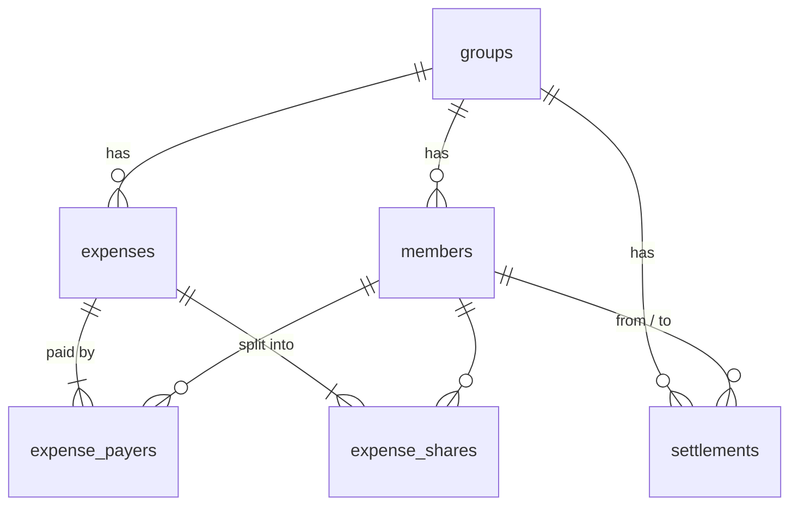

# Architecture

This document explains how Evenly is put together and why. It is aimed at contributors and at
anyone reading the code to learn from it.

## Goals

1. **Correct money.** A splitting app that is off by a cent is broken. All arithmetic is integer,
   and every split provably adds up to its total.
2. **Offline-first.** The app must work on a plane. There is no backend; SQLite is the source of
   truth and Redux is a cache of it.
3. **Testable core.** Business rules should be testable without a simulator, a device or even
   React.

## Layers

```
screens/components ──► store (thunks, selectors) ──► domain
                              │
                              └──► data (repositories) ──► SQLite
```

Dependencies only point to the right. `domain` imports nothing from the rest of the app and has
no third-party dependencies at all.

### Domain (`src/domain`)

| Module | Responsibility |
| --- | --- |
| `money.ts` | Minor units, currency exponents, locale-tolerant parsing, formatting, `allocate()` |
| `split.ts` | Split inputs (equal / exact / percentage / shares), payer inputs, method conversion |
| `balances.ts` | Net balances, pairwise debts, summaries, per-expense impact |
| `simplify.ts` | Minimum-transfer settlement (exact subset DP with greedy fallback) |
| `validation.ts` | Expense, name and settlement validation returning typed error codes |
| `csv.ts` | RFC 4180 export with formula-injection protection |
| `activity.ts` | Activity feed and month grouping |

Validation returns **codes**, not strings. User-facing copy lives in `src/utils/messages.ts`,
which keeps the domain free of presentation concerns and puts all copy in one place for
translation.

### Data (`src/data`)

The repositories depend on a deliberately small interface:

```ts
interface SqlDatabase {
  execAsync(sql): Promise<void>;
  runAsync(sql, params?): Promise<SqlRunResult>;
  getAllAsync<T>(sql, params?): Promise<T[]>;
  getFirstAsync<T>(sql, params?): Promise<T | null>;
  withTransactionAsync(task): Promise<void>;
}
```

`openDatabase.ts` adapts `expo-sqlite` to it; `src/test/createTestDatabase.ts` adapts `sql.js`
(SQLite compiled to WebAssembly). The same SQL, constraints and migrations therefore run in unit
tests and on device.

#### Schema



- Payers and shares are stored as rows (not JSON) so they can be indexed and constrained.
- The raw split input (`split_json`) is stored alongside the computed shares so an expense can be
  re-opened in the editor exactly as it was entered. If it is ever unreadable, the repository
  falls back to an exact split that reproduces the stored shares, so balances never change.
- `CHECK` constraints reject non-positive amounts and self-payments at the database level.
- `ON DELETE RESTRICT` on member references means a member who is part of the ledger cannot be
  deleted by accident; the repository surfaces this as a typed `MemberInUseError`.

#### Migrations

`migrations.ts` holds an append-only list. The current version is SQLite's `user_version`
pragma. Each migration runs in its own transaction together with the version bump, so a failed
migration leaves the database exactly at the previous version (covered by a test).

### State (`src/store`)

- One slice per entity using `createEntityAdapter`, plus `app` (boot status) and `settings`.
- Thunks are created with `createAsyncThunk.withTypes`, and receive `{ repos, clock, ids }` via
  the thunk `extraArgument`. Tests inject a real in-memory database, a fixed clock and sequential
  ids.
- Writes are **pessimistic**: the thunk writes to SQLite first and the slice updates on
  `fulfilled`. With a local database the latency is negligible and it removes a whole class of
  rollback bugs. Settings are the one optimistic exception, because toggling a switch should
  feel instant.
- Derived data (balances, settlement plans, overviews, activity) is never stored. It is computed
  by memoised selectors from the normalised entities.

### UI (`src/screens`, `src/components`)

- `components/ui` contains a small design system (Text, Button, TextField, Card, ListRow, …)
  driven by theme tokens in `src/theme/tokens.ts`.
- The expense editor's state lives in `useExpenseForm`, which wires inputs to the domain
  validators and decides when errors become visible (split and payer errors live, others after
  the first submit).
- Partially typed numbers such as `12.` are kept as local text state inside input cells and only
  the parsed value is lifted up, so typing never fights the parser.

## Key decisions

**Why no backend?** Splitting within a trip or a flat is a small, private dataset. A local
database keeps the app fast, private and usable offline. Sync is on the roadmap and the
normalised schema with UUID primary keys was chosen to make that possible later.

**Why Redux Toolkit instead of querying SQLite from components?** Balances depend on *every*
expense and payment in a group. Holding the entities in memory and deriving balances with
memoised selectors keeps every screen consistent after any write without re-querying.

**Why integer minor units and BigInt in `allocate`?** Floating-point cents drift. Integers are
exact, and the intermediate product `amount × weight` in `allocate` uses BigInt so even the
largest allowed amount with the largest weight cannot lose precision.

**Why an exact simplification algorithm?** Greedy "largest debtor pays largest creditor" is
intuitive but not optimal. Groups are small (rarely more than a dozen people with a non-zero
balance), so an exact O(2ⁿ·n) dynamic programme is affordable and always produces the fewest
payments. See [`ALGORITHMS.md`](ALGORITHMS.md).
